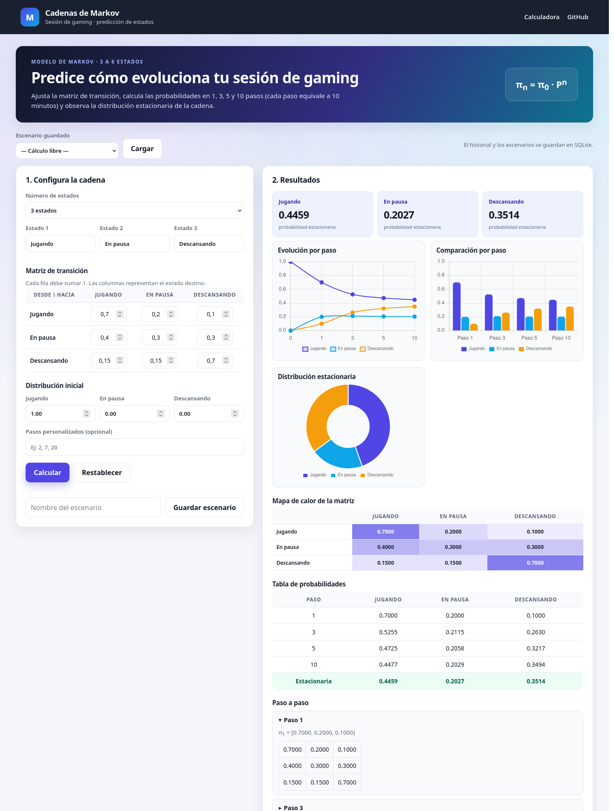

# Cadenas de Markov · Sesión de gaming

Aplicación web para predecir la evolución de una sesión de videojuegos mediante una
cadena de Markov. El usuario edita la matriz de transición, calcula las probabilidades
en 1, 3, 5 y 10 pasos (cada paso equivale a 10 minutos), añade pasos personalizados y
consulta la distribución estacionaria de la cadena.

El proyecto se desarrolló con **Spec-Driven Development (SDD)** usando **OpenSpec**:
primero la propuesta, la especificación, el diseño y las tareas; después la
implementación y las pruebas.

[](https://github.com/eragon1020/Matrizmarkov/actions/workflows/tests.yml)
[](https://eragon1020.github.io/Matrizmarkov/)
[](https://render.com/deploy?repo=https://github.com/eragon1020/Matrizmarkov)

## Enlaces

| Recurso | URL |
|---|---|
| Repositorio | https://github.com/eragon1020/Matrizmarkov |
| Landing / demo estática (GitHub Pages) | https://eragon1020.github.io/Matrizmarkov/ |
| Aplicación interactiva (Render) | https://matrizmarkov-eragon1020.onrender.com |

> GitHub Pages solo sirve archivos estáticos, por eso aloja una **demo generada con el
> mismo motor Python**. La aplicación interactiva con Flask y SQLite se ejecuta en
> Render o en local.



## Tema y modelo

**Problema:** predecir el comportamiento de un jugador durante una sesión de
videojuegos. Cada paso representa 10 minutos.

| Estado | Descripción |
|---|---|
| `Jugando` | El jugador está en una partida activa. |
| `En pausa` | El jugador está en menús, tienda o chat. |
| `Descansando` | El jugador está fuera del juego. |

Matriz de transición por defecto (cada fila suma 1):

```text
             Jugando  En pausa  Descansando
Jugando        0.70     0.20       0.10
En pausa       0.40     0.30       0.30
Descansando    0.15     0.15       0.70
```

Distribución inicial: `π₀ = [1, 0, 0]` (la sesión empieza jugando).

Fórmula aplicada:

```text
πₙ = π₀ · Pⁿ
```

Resultados de referencia:

| Pasos | Jugando | En pausa | Descansando |
|---:|---:|---:|---:|
| 1 | 0.7000 | 0.2000 | 0.1000 |
| 3 | 0.5255 | 0.2115 | 0.2630 |
| 5 | 0.4725 | 0.2058 | 0.3217 |
| 10 | 0.4477 | 0.2029 | 0.3494 |
| **Estacionaria** | **0.4459** | **0.2027** | **0.3514** |

Interpretación: al inicio el jugador está jugando con probabilidad 1; tras 100 minutos
la probabilidad de seguir jugando baja a ~44.8 % y la de descansar sube a ~34.9 %. A
largo plazo reparte su tiempo aproximadamente en 44.6 % jugando, 20.3 % en pausa y
35.1 % descansando.

## Características

- Matriz de transición editable para **3 a 6 estados**.
- Validación de matriz y distribución inicial (rangos, filas que suman 1, tolerancia 1e-9).
- Cálculo de **1, 3, 5 y 10 pasos** y de pasos personalizados.
- **Distribución estacionaria** resolviendo `πP = π` con `Σπ = 1`.
- Gráficas de líneas, barras y dona, más mapa de calor de la matriz.
- Tabla de resultados y sección **paso a paso** con `Pⁿ` y `πₙ`.
- Guardado de escenarios e historial de cálculos en **SQLite**.
- Funciona con JavaScript y también sin él (envío de formulario tradicional).
- Health check en `/api/salud` para Render.
- Pruebas automatizadas con pytest y cobertura ≥ 85 %.

## Tecnologías

| Capa | Tecnología |
|---|---|
| Backend | Python 3.14 + Flask 3 |
| Motor matemático | Python puro (sin NumPy) |
| Base de datos | SQLite (`sqlite3` de la biblioteca estándar) |
| Frontend | Jinja2 + CSS + JavaScript vanilla + Chart.js 4 |
| Pruebas | pytest + pytest-cov + cliente de pruebas de Flask |
| SDD | OpenSpec 1.16 (esquema `spec-driven`) |
| Despliegue | Render (Gunicorn) + GitHub Pages |

## Estructura

```text
Matrizmarkov/
├── app/
│   ├── markov.py            # validación, potencias, estacionaria
│   ├── db.py                # SQLite: escenarios e historial
│   ├── web.py               # Flask: rutas HTML y API JSON
│   ├── config.py            # escenario por defecto
│   ├── templates/           # base.html e index.html
│   └── static/              # CSS, JS y Chart.js
├── tests/                   # 112 pruebas automatizadas
├── scripts/build_docs.py    # genera la landing de Pages
├── docs/                    # landing estática, captura y Chart.js
├── openspec/                # propuesta, spec, diseño, tareas y specs
├── wsgi.py                  # entrada para Gunicorn
├── render.yaml              # Blueprint de Render
├── requirements.txt
├── requirements-dev.txt
└── pytest.ini
```

## Instalación y ejecución local

Requisitos: Python 3.10 o superior (probado con 3.14).

```bash
python3 -m venv .venv
source .venv/bin/activate
pip install -r requirements-dev.txt

# Servidor de desarrollo
flask --app wsgi run --debug
```

Abre `http://127.0.0.1:5000`.

También puedes usar Gunicorn:

```bash
gunicorn --workers 1 --threads 4 --worker-class gthread --bind 127.0.0.1:8000 wsgi:app
```

La base de datos se crea automáticamente en `data/markov.db`. Puedes cambiar la ruta
con la variable de entorno `DATABASE_PATH`:

```bash
DATABASE_PATH=/tmp/markov.db flask --app wsgi run --debug
```

Para regenerar la landing de GitHub Pages:

```bash
python scripts/build_docs.py
```

## Pruebas

```bash
# Suite completa
pytest -q

# Cobertura con umbral mínimo
pytest --cov=app --cov-report=term-missing --cov-fail-under=85
```

Estado actual: **112 pruebas superadas** y **95.85 % de cobertura**.

La suite cubre:

- Motor matemático: multiplicación, potencias, valores de referencia 1/3/5/10,
  filas que suman 1, estacionaria y propiedad `πP = π`, cadenas de 4 estados.
- Validaciones: matriz no cuadrada, valores fuera de rango, filas que no suman 1,
  distribución inicial inválida, estados vacíos o duplicados, valores no finitos.
- Persistencia: creación de tablas, seed idempotente, escenarios e historial,
  nombres duplicados sin distinguir mayúsculas ni acentos.
- API: cálculo válido e inválido, pasos personalizados, historial, CRUD de escenarios,
  health check y asociación del cálculo a un escenario.
- Render: HTML con estados, gráficas, tabla, mapa de calor, datos embebidos y errores.
- Configuración: `render.yaml`, `wsgi.py`, workflow de CI, `.gitignore` y landing.

El workflow `.github/workflows/tests.yml` ejecuta la suite con cobertura en Python 3.14
en cada push y pull request a `main`.

## API

| Método | Ruta | Descripción |
|---|---|---|
| `GET` | `/` | Página principal con el escenario por defecto |
| `POST` | `/calcular` | Cálculo con formulario (fallback sin JavaScript) |
| `POST` | `/api/calcular` | Cálculo JSON |
| `GET` | `/api/escenarios` | Lista escenarios guardados |
| `POST` | `/api/escenarios` | Guarda un escenario (nombre único) |
| `GET` | `/api/escenarios/<id>` | Recupera un escenario |
| `GET` | `/api/historial?limite=10` | Últimos cálculos |
| `GET` | `/api/salud` | Health check de la app y la base de datos |

Ejemplo de cálculo:

```bash
curl -X POST http://127.0.0.1:5000/api/calcular \
  -H "Content-Type: application/json" \
  -d '{
    "estados": ["Jugando", "En pausa", "Descansando"],
    "matriz": [[0.7, 0.2, 0.1], [0.4, 0.3, 0.3], [0.15, 0.15, 0.7]],
    "distribucion_inicial": [1, 0, 0],
    "pasos_personalizados": "7"
  }'
```

Respuesta (resumida):

```json
{
  "ok": true,
  "resultado": {
    "estados": ["Jugando", "En pausa", "Descansando"],
    "resultados": [
      {"paso": 1, "probabilidades": [0.7, 0.2, 0.1], "matriz": [[...]], "personalizado": false}
    ],
    "estacionaria": [0.4459459459, 0.2027027027, 0.3513513514]
  }
}
```

Errores de validación: código `400` con `{"ok": false, "error": "..."}`.
Nombre duplicado: código `409`. Escenario inexistente: código `404`.

## Base de datos

Dos tablas en SQLite:

- `escenarios`: nombre, nombre normalizado único, estados, matriz, distribución inicial
  y fecha de creación.
- `calculos`: escenario asociado (opcional), pasos, resultados, distribución estacionaria
  y fecha.

Al arrancar, la aplicación ejecuta `init_db()` y `seed_default_scenario()`. El seed es
idempotente: siempre existe el escenario por defecto sin duplicarse.

**Render gratis usa un sistema de archivos efímero.** El historial se pierde al
reiniciar o redeployar, pero la app se reinicializa y sigue funcionando. Para persistir
datos se puede usar un disco persistente (plan pago) o Render Postgres.

## OpenSpec y SDD

El cambio se gestionó con el esquema `spec-driven`:

```text
propuesta → especificación → diseño → tareas → implementación → archivo
```

El cambio `cadenas-markov-gaming` quedó **archivado** y sus requisitos se promovieron
a la especificación vigente:

- `openspec/changes/archive/2026-11-19-cadenas-markov-gaming/proposal.md`
- `openspec/changes/archive/2026-11-19-cadenas-markov-gaming/specs/prediccion-markov/spec.md`
- `openspec/changes/archive/2026-11-19-cadenas-markov-gaming/design.md`
- `openspec/changes/archive/2026-11-19-cadenas-markov-gaming/tasks.md`
- `openspec/specs/prediccion-markov/spec.md` (especificación vigente)

Comandos usados:

```bash
openspec init --tools opencode --language es --profile core
openspec new change cadenas-markov-gaming --schema spec-driven
openspec validate cadenas-markov-gaming --strict
openspec validate --all --strict
openspec archive cadenas-markov-gaming -y
```

Al archivar, los requisitos se promueven a
`openspec/specs/prediccion-markov/spec.md` y el cambio queda en
`openspec/changes/archive/`.

Cada fase quedó registrada en un commit independiente para evidenciar el proceso en
Git y GitHub.

## Despliegue en Render

El repositorio incluye `render.yaml` con un servicio web gratuito:

- Runtime Python 3.14.10.
- Build: `pip install -r requirements.txt`.
- Start: Gunicorn con un worker y cuatro hilos (seguro para SQLite).
- Health check: `/api/salud`.
- Variables: `SECRET_KEY`, `APP_ENV`, `DATABASE_PATH`, `PYTHON_VERSION`.
- Auto-deploy en cada push a `main`.

Pasos:

1. Crear una cuenta en [Render](https://render.com) y conectar GitHub.
2. Pulsar el botón **Deploy to Render** del inicio del README o entrar en
   `New → Blueprint`, seleccionar `eragon1020/Matrizmarkov` y aplicar el Blueprint.
3. Esperar el build y abrir la URL `https://<servicio>.onrender.com`.
4. Si cambia la URL, actualizarla en este README y en `docs/index.html`.

Limitaciones del plan gratuito:

- El servicio se suspende tras 15 minutos sin tráfico y tarda ~1 minuto en despertar.
- El sistema de archivos es efímero: el historial de SQLite se reinicia.
- No permite discos persistentes; para eso se requiere un plan pago.

## GitHub Pages

La carpeta `docs/` contiene la landing estática generada con
`python scripts/build_docs.py`. Para publicarla:

1. Ir a `Settings → Pages`.
2. Seleccionar `Deploy from a branch`.
3. Elegir la rama `main` y la carpeta `/docs`.
4. Guardar y esperar la URL `https://eragon1020.github.io/Matrizmarkov/`.

## Uso de IA

El proyecto se desarrolló con asistencia de **opencode** como agente de IA, siguiendo
SDD: primero se escribieron y validaron los artefactos de OpenSpec, después se implementó
el motor matemático, la persistencia, la interfaz y las pruebas. Las decisiones de
diseño, la matriz del modelo, los valores de referencia y los criterios de aceptación
están documentados en `openspec/` y verificados por la suite de pruebas.

## Autor

**Bryam Aragón** · [@eragon1020](https://github.com/eragon1020)

Actividad final de desarrollo con OpenSpec y cadenas de Markov · Noviembre de 2026.

## Licencia

MIT. Chart.js se distribuye bajo su propia licencia MIT; consulta
`app/static/vendor/CHARTJS_LICENSE.md`.
